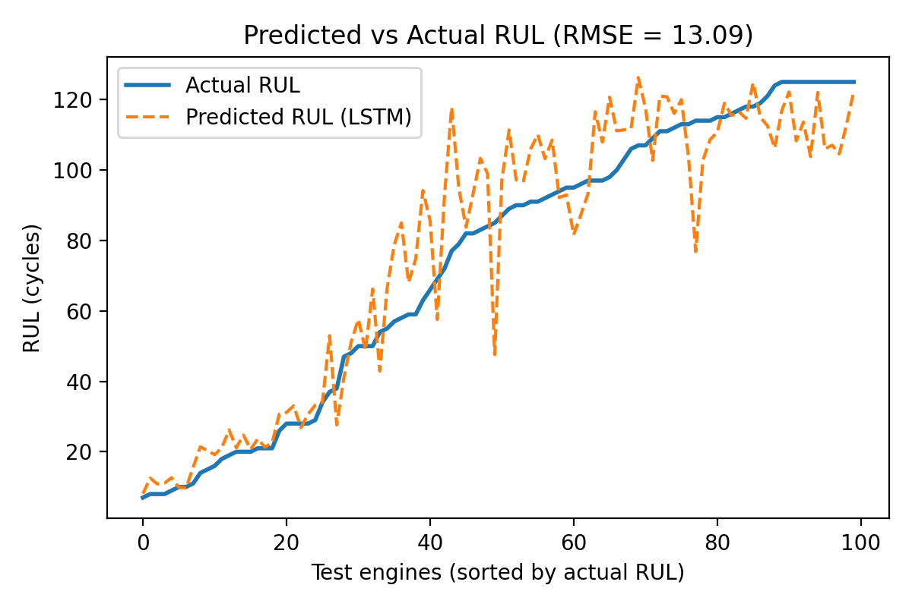
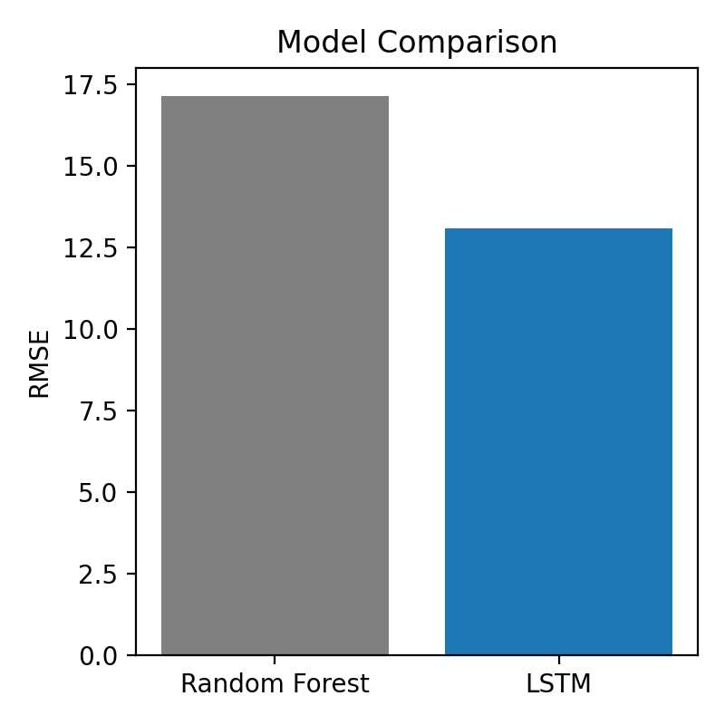

# Predictive Maintenance and RUL Estimation using LSTM

Deep Learning Techniques (DLT) project by **S Srihari**, B.Tech AI, SRM IST Tiruchirappalli.

Estimates the **Remaining Useful Life (RUL)** of turbofan engines from sensor data using an LSTM, and compares it with a Random Forest baseline.

## Dataset
NASA C-MAPSS **FD001** (`train_FD001.txt`, `test_FD001.txt`, `RUL_FD001.txt`). Not included in this repo; download from NASA / Kaggle and place the 3 files next to the script.

## Method
1. Label RUL per engine (capped at 125 cycles)
2. Select 14 informative sensors, MinMax scale
3. Sliding window of 30 cycles
4. 2-layer LSTM (64, 32 units) + Dropout 0.2 + Dense output
5. Evaluate with RMSE on the test set

## Results
| Model | RMSE (lower is better) |
|---|---|
| Random Forest (baseline) | 17.16 |
| LSTM | **13.09** |




## Run it
```
pip install numpy pandas matplotlib scikit-learn tensorflow
python rul_project.py
```
(Or paste `rul_project.py` into Google Colab and upload the 3 data files.)

## Files
- `rul_project.py` - full pipeline (preprocessing, LSTM, baseline, plots)
- `index.html` - project website
- `pred_vs_actual.png`, `model_comparison.png` - result plots

## Future work
GRU / attention models, FD002-FD004 (multiple operating conditions), real-time deployment.
